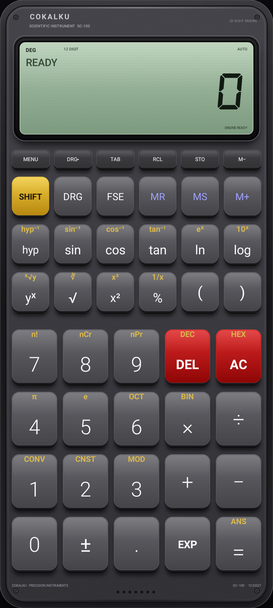
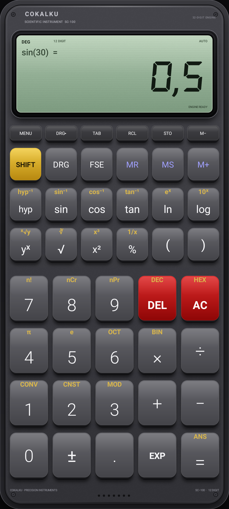
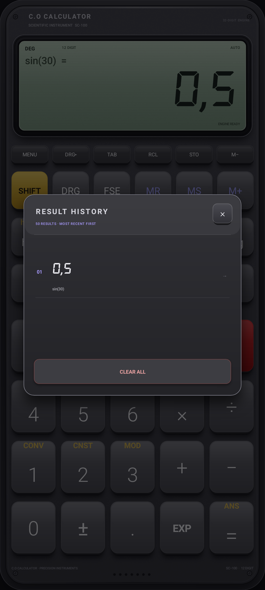
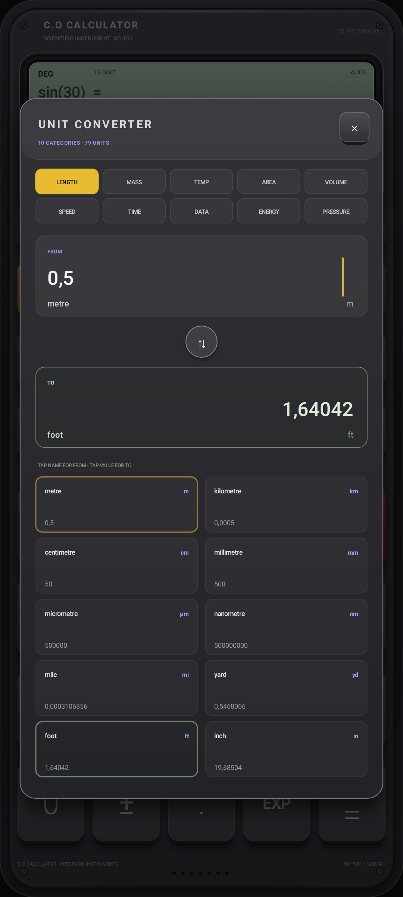
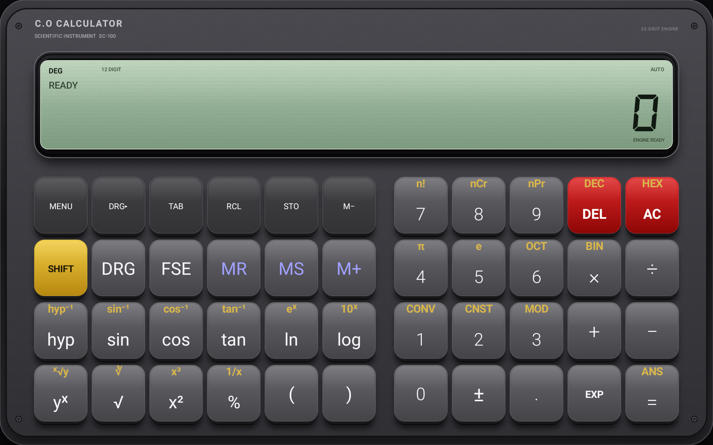
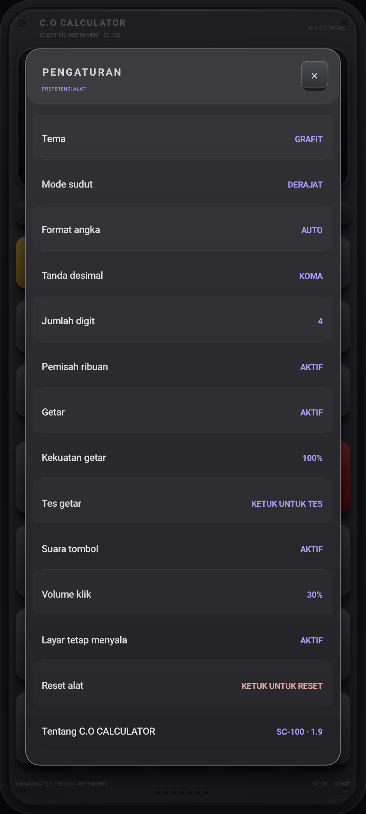
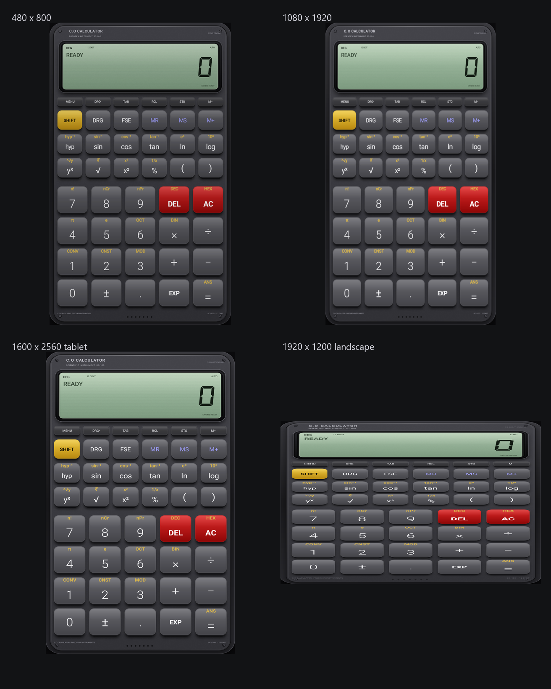

# C.O CALCULATOR SC-100

**Repository:** [github.com/chandraokta/C.O-CALCULATOR](https://github.com/chandraokta/C.O-CALCULATOR)  
**Latest release:** [v1.9 — C.O CALCULATOR](https://github.com/chandraokta/C.O-CALCULATOR/releases/tag/v1.9)

A new Android scientific calculator with the tactile, physical-instrument feel of a classic
pocket calculator. The product and interface are original; the feature set and the level of
realism were informed by RealCalc Scientific Calculator 3.1.1.

**No RealCalc code, artwork, fonts, or branding is used in this app.**



## Running on a 1080 × 2400 device

These captures are from the actual APK on an Android 11 x86_64 emulator (1080 × 2400,
420 dpi). They are screenshots of the running app, not renders of the design file.

| | |
|---|---|
|  |  |
| **Calculator:** the full instrument, edge to edge, with the seven-segment LCD. | **Live calculation:** `sin(30)` in DEG mode evaluates to exactly `0.5` on the LCD. |
|  |  |
| **Result history** opens from `SHIFT` + `=` (the `ANS` legend). Tap any row to reuse it. | **Unit converter** keeps the current value and converts into every listed unit live. |
|  |  |
| **Landscape 1920 × 1200 tablet:** scientific keys on the left and a familiar 5-column number pad on the right. | **Pengaturan:** menu Indonesia dengan label besar, getar, dan suara tombol. |



Diuji pada 480 × 800, 1080 × 1920, 1080 × 2400, 1600 × 2560 (tablet), 800 × 480, dan 1920 × 1200 (landscape tablet).

## What is in this repository

| Path | What it is |
|---|---|
| [`app/`](app) | The complete Android application, Java + custom Canvas drawing |
| [`C.O-CALCULATOR.apk`](C.O-CALCULATOR.apk) | APK final, signed dan siap dipasang |
| [`design/cokalku-sc100.figcraft`](design/cokalku-sc100.figcraft) | Editable FigCraft design file (four screens) |
| [`design/export/`](design/export) | Exported 2× design screens |
| [`design/cokalku-icon.figcraft`](design/cokalku-icon.figcraft) | FigCraft app-icon source |
| [`app/build.ps1`](app/build.ps1) | Reproducible build without Gradle |
| [`docs/DESIGN.md`](docs/DESIGN.md) | Design system, dimensions and visual decisions |
| [`docs/PANDUAN.md`](docs/PANDUAN.md) | Panduan lengkap semua fitur dan contoh perhitungan |
| [`docs/CONTOH-PENGGUNAAN.md`](docs/CONTOH-PENGGUNAAN.md) | Contoh perhitungan untuk setiap fitur |
| [`docs/RESPONSIVE.md`](docs/RESPONSIVE.md) | Matriks pengujian berbagai ukuran layar |

## The four designed screens

| | |
|---|---|
|  |  |
| **01 — Calculator:** graphite face, inset green LCD, six-column scientific block and five-column number block. | **02 — Result history:** the same instrument dimmed behind a milled metal panel. |
|  |  |
| **03 — Unit converter:** category chips, from/to cards and live common-unit rows. | **04 — Landscape:** two-panel tablet layout for wide screens. |

## Panduan penggunaan

Panduan lengkap semua tombol, fitur, dan contoh perhitungan ada di
[`docs/PANDUAN.md`](docs/PANDUAN.md). Contoh untuk setiap fitur ada di
[`docs/CONTOH-PENGGUNAAN.md`](docs/CONTOH-PENGGUNAAN.md). Ringkasnya:

- `SHIFT` + tombol = fungsi kuning (atau tahan tombol).
- `SHIFT` + `1` = konverter, `SHIFT` + `2` = konstanta, `SHIFT` + `3` = `mod`.
- `SHIFT` + `=` = riwayat hasil; `MENU` = pengaturan.

## Features

- **Traditional algebraic entry** with operator precedence, parentheses, unary minus and implicit
  multiplication (`2π`, `2(3+4)`).
- **Scientific functions:** sin, cos, tan, inverse and hyperbolic variants, `ln`, `log`,
  `eˣ`, `10ˣ`, powers, square/cube roots, reciprocal, factorial, `nCr`, `nPr`, `mod`.
- **Function-first entry:** press `sin`, then `30`, then `=` — the app closes the
  parenthesis for you. The expression line above the result is twice as large as before.
- **Angle modes:** degrees, radians and grads.
- **12-digit LCD** with a real seven-segment typeface, superscript exponents and status
  indicators (DEG/RAD/GRAD, 2nd, HYP, M, 12 DIGIT).
- **AUTO / FIX / SCI / ENG** number formats, selectable decimals and thousands grouping.
- **History** of the last 50 results, tap any row to reuse the value.
- **Main memory plus nine storage slots**, with recall/store, M+, M− and clear.
- **Unit converter:** length, mass, temperature, area, volume, speed, time, data, energy and
  pressure, with live conversion in every listed unit.
- **Constants:** mathematical and physical constants, tap to insert.
- **Radix view:** the current value in decimal, hexadecimal, octal and binary.
- **Three finishes:** Graphite, Silver and Midnight; setting is persisted.
- **Vibration (Getar) and key-click sound**, with on/off switches, adjustable vibration
  strength and click volume (defaults: vibration on, strength 100%, sound on, volume 30%).
- **Decimal mark:** comma by default (`0,001`), with a dot option (`0.001`).
- **Press feedback:** every key flashes darker while pressed and fades back.
- **Language:** calculator interface is English; the Settings menu is fully Indonesian.
- **Vibration test:** a dedicated Settings row sends a 1.5-second pattern and reports if no motor is detected.
- **Portrait and landscape** layouts, immersive full-screen, keep-awake.
- **32-digit internal arithmetic** using `BigDecimal` (DECIMAL128) for the four basic
  operations; transcendental functions use double precision and are formatted to 12 digits.

## Build

The project deliberately avoids Gradle and AndroidX, so the APK can be built from the command
line with the Android SDK build-tools only.

Prerequisites in `.tools/` (already present in this workspace):

- Temurin JDK 17
- Android SDK platform 35 and build-tools 35.0.0

```powershell
pwsh -NoProfile -File app\build.ps1
```

The script runs:

1. `aapt2 compile` / `aapt2 link`
2. `javac` (Java 17, `android.jar` classpath)
3. `d8` dexing
4. `zipalign`
5. `apksigner` with a local debug keystore

Output: `app/build/C.O-CALCULATOR.apk`; salinannya tersedia di `C.O-CALCULATOR.apk` pada root proyek.

Install on a connected device:

```powershell
adb install -r app\build\C.O-CALCULATOR.apk
```

## Design

The four screens were drawn in **FigCraft** at 412 × 915 dp (portrait) and 915 × 412 dp
(landscape). Open `design/cokalku-sc100.figcraft` in FigCraft to edit the native layers; the
`design/build_design.py` script is the repeatable generator for those layers.

Design details:

- 9 dp machined outer rail, 26 dp face plate, four corner screws.
- Green LCD: `#B3CDB1 → #7E9C81`, ink `#111A12`, glass highlight and scanlines.
- Graphite keys: `#67676D → #444449` with a 3 dp extruded lower edge.
- SHIFT is safety yellow `#F2CC42 → #B78810`; DEL/AC are `#E02A2A → #8E0606`.
- Memory keys and dialog indexes use violet `#A0A0FF`.
- Status and legends use warm yellow `#D9B64B`.
- The app icon is also a FigCraft drawing.

## Implementation notes

- `CalculatorView` draws the entire instrument with `Canvas`; there are no bitmap skins and
  no XML layouts. A cached `Bitmap` holds the static body, LCD bezel and keycaps, while the LCD
  text, pressed key and overlays are drawn each frame.
- The keypad, legends and secondary functions are data-driven (`Key` objects), so portrait and
  landscape share the same input logic.
- `CalcEngine` is a recursive-descent parser with a small AST and contextual percentages
  (`200 + 10% = 220`), so the same engine can later serve an RPN or programming mode.
- The APK targets Android 15 (API 35), minSdk 23, and requires only `VIBRATE`.

## Limitations / next steps

- RPN entry modes, fractions, degrees/minutes/seconds and editable conversion/constant XML are
  not implemented in this first release.
- Radix support is a conversion viewer; arithmetic is decimal.
- Copy/paste from the LCD and the home-screen widget are not implemented.
- The build is a debug-signed APK; replace `app/build/cokalku.keystore` for a production release.

## Reference

Feature and interaction inspiration: [RealCalc Scientific Calculator on Google Play](https://play.google.com/store/apps/details?id=uk.co.nickfines.RealCalc)
and the APK supplied in this workspace for study. The seven-segment typeface is
[DSEG7 Classic](https://github.com/keshikan/DSEG) (SIL Open Font License); its license is
included at `app/assets/fonts/DSEG-OFL.txt`; the runtime copy is `app/res/raw/dseg.ttf`.


